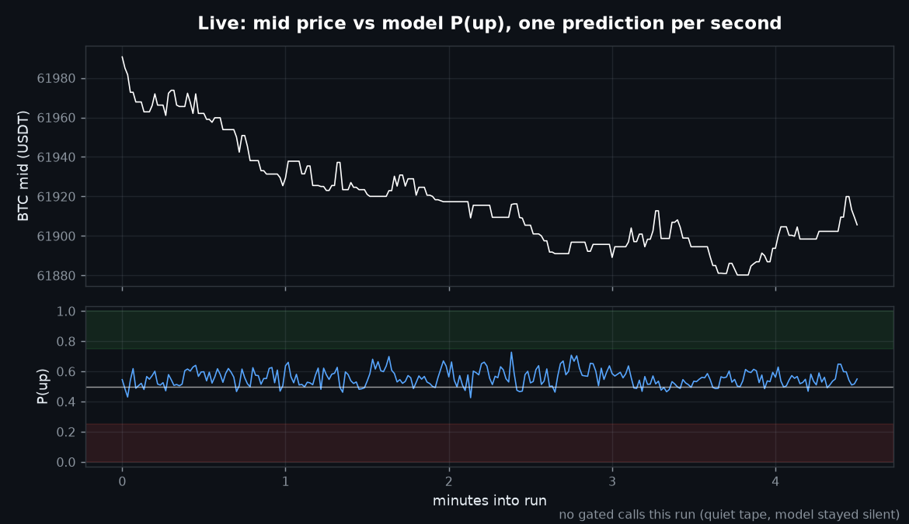
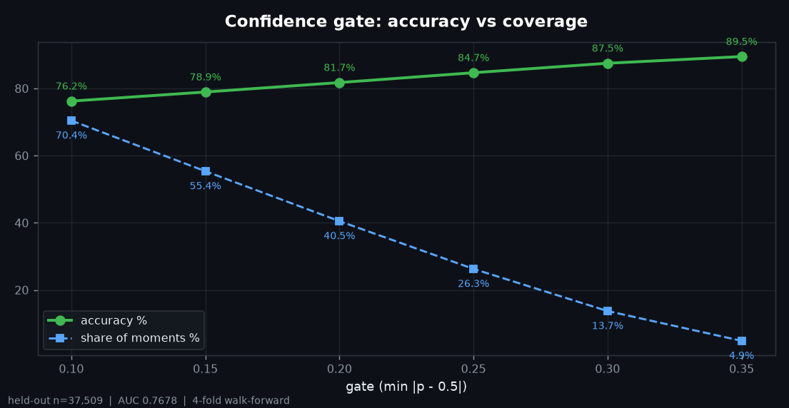

# Ten-second BTC direction from the order book

[](https://github.com/vaproh/btc-orderbook-predictor/actions/workflows/ci.yml)
[](https://www.python.org/)
[](LICENSE)

Predicts whether BTC's mid price will be higher or lower **ten seconds from now**,
from top-of-book quote state: order book imbalance, microprice deviation, order
flow imbalance, spread, and quote arrival intensity.


_A live run: mid price against the model's P(up), one prediction per second.
Green and red ticks are gated calls, right and wrong._


_Confidence gate on held-out data (n=37,509): accuracy climbs as the model is
allowed to stay silent more often. Both numbers must be quoted together._

The interesting result is not the model, it is the comparison. Across this project
every price-series feature family was tried, momentum, mean reversion,
volatility, RSI, MACD, Bollinger, higher timeframes, trade flow, and all of them
plateaued around 57-60% accuracy. Order book state alone reaches **70.6%**, and
**84.7%** when it only speaks at high confidence.

---

## Results

Trained on three days of Binance USD-M futures `bookTicker` (28-30 March 2024),
one-second bars, flat windows excluded.

**Feature families, identical rows and split:**

| feature block | features | AUC | accuracy |
|---|---|---|---|
| **order book only (shipped)** | 58 | **0.7680** | **70.6%** |
| book + price | 81 | 0.7679 | 70.3% |
| price only | 23 | 0.6892 | 63.9% |

Book alone is not just competitive, it is marginally better than the pair. Price
information is already contained in the book at this horizon.

**Walk-forward, four sequential blocks, each trained only on prior data:**

| fold | AUC | accuracy | accuracy at 25% gate |
|---|---|---|---|
| 1 | 0.7896 | 72.0% | 86.4% |
| 2 | 0.7688 | 70.3% | 83.1% |
| 3 | 0.7659 | 69.8% | 84.8% |
| 4 | 0.7587 | 69.6% | 82.2% |
| **mean** | **0.7708** | | **84.1%** |

4/4 above 0.5. Minimum AUC 0.7587.

**Confidence gate on held-out data (37,509 rows):**

| gate | calls | share of moments | accuracy |
|---|---|---|---|
| 10% | 26,410 | 70.4% | 76.2% |
| 15% | 20,761 | 55.3% | 78.9% |
| 20% | 15,189 | 40.5% | 81.7% |
| **25%** | **9,855** | **26.3%** | **84.7%** |
| 30% | 5,151 | 13.7% | 87.5% |
| 35% | 1,824 | 4.9% | 89.5% |

Higher accuracy is bought with coverage. Both numbers must be quoted together.

**Live, October 2026** (a 2024-trained model against the real stream, 1.7 hours):
**80.0% at the 25% gate on 859 calls**, 95% CI [77.3, 82.7].

---

## Data

All training rows derive from one public source:

```
https://data.binance.vision/data/futures/um/daily/bookTicker/BTCUSDT/
BTCUSDT-bookTicker-YYYY-MM-DD.zip
```

One file per day, roughly 50-150 MB compressed, about 120 best-bid/ask updates
per second with millisecond timestamps and sizes on both sides. No trades, no
deeper levels, no funding, no spot data. The build step folds each day into
one-second bars (`sec, bid, ask, bidq, askq, mid, micro, spread, ofi, n`), which
is the only DataFrame the model ever sees.

The shipped model used 2024-03-28 through 2024-03-30, about 186k training rows
after excluding flat windows. That archive stops in April 2024, so anything
trained from it is trained on old data. The live harness (`btcbook-live`)
exists precisely to re-check old numbers against the current stream, and the
`--bars-out` flag records fresh bars in the same parquet format for retraining.

---

## How it works

```
bookTicker tick (bid, ask, bid_qty, ask_qty, ms timestamp)
        │
BookBars: fold ticks into 1s bars (OFI summed per second, gaps carried forward)
        │
58 features in five groups: imbalance (+lags/diffs), microprice deviation,
spread (+ratio/ma), quantities (+ratios/moves), OFI (sums/means/std/agreement,
1s to 300s windows)
        │
LightGBM binary classifier → P(up 10s from now)
        │
gate on |p - 0.5|: speak only past the threshold, else stay silent
```

`predict()` returns `{'p_up', 'lean', 'call', 'mid'}` or `None` while warming
up. Warmup is 320 one-second bars, about five minutes, because that is the
longest feature window. It also returns `None` rather than guessing when any
feature is not finite.

Three quantities carry most of the signal:

- **Order book imbalance** — `(bid_qty − ask_qty) / (bid_qty + ask_qty)` at the
  touch. 9.8% of total model gain.
- **Microprice deviation** — `(microprice − mid) / mid`, where the microprice
  weights each side by the *opposite* side's size. 7.5% of gain.
- **Order flow imbalance** (Cont, Kukanov & Stoikov 2014) — a bid that grows, or
  an ask that shrinks, is positive pressure. Summed over 1 to 300 seconds.

Plus relative spread and quote arrival intensity, how fast the book churns.

The literature predicts this. Cont-Kukanov-Stoikov established the OFI result;
DeepLOB and its descendants show order book state predicts short-horizon
direction. One public repo reports AUC 0.708 on this exact ten-second task using
L2 imbalance. This one reaches 0.768 with L1 only.

---

## How it was trained

`src/btcbook/train.py`, one command end to end:

```bash
btcbook-train --parquet book_1s.parquet --out models/
```

1. **Prepare.** Bars load from parquet, features build per bar, labels come
   from the log return ten seconds forward. Flat windows are excluded, a zero
   move is neither up nor down, and labelling it `return > 0` silently files
   20.7% of windows as DOWN, which manufactures a fake 63/37 drift.
2. **Split chronologically, 80/20**, with the training side cut a full horizon
   short of the boundary so no label leaks across it.
3. **Fit** LightGBM (`num_leaves=63, min_child_samples=1000, n_estimators=500,
   lr=0.03, subsample/colsample 0.8, L2 1.0, seed 42`) on the 58 book-only
   columns.
4. **Validate twice.** First the holdout AUC, accuracy, and the full gate
   sweep. Then four sequential walk-forward folds, each trained only on data
   before its test block. A model that scores on one split has shown one
   observation; surviving all four sequential blocks is the actual claim.
5. **Export** `models/obi_book.txt` and `models/obi_book_meta.json`, which
   record the feature list, horizon, scores, gates, walk-forward AUCs, row
   counts, and training window, so any result can be traced back to the exact
   artifact that produced it.

---

## Use

```bash
uv sync
uv run python -c "from btcbook import ObiPredictor"
```

```python
from btcbook import ObiPredictor

p = ObiPredictor()
p.on_tick(bid=80000.0, ask=80001.0, bid_qty=2.5, ask_qty=1.1)
# ... feed ticks for ~320 seconds to fill the bar buffer ...
out = p.predict()
# {'p_up': 0.63, 'lean': 0.13, 'call': 'UP', 'mid': 80000.5}
```

## Train

```bash
# download a few days of archives
python -c "from btcbook.build import fetch_day, build_bars; \
  [fetch_day(d) for d in ('2024-03-28','2024-03-29','2024-03-30')]; \
  build_bars(['bt-2024-03-28.zip','bt-2024-03-29.zip','bt-2024-03-30.zip'])"

uv run btcbook-train --parquet book_1s.parquet --out models/
```

Prints the holdout result, the gate curve, and the walk-forward table, then writes
`models/obi_book.txt` and `models/obi_book_meta.json`.

## Live test

```bash
uv run btcbook-live --seconds 3600 --gate 0.25 --ledger live_ledger.csv
uv run btcbook-eval --ledger live_ledger.csv --bars book_1s_live.parquet
```

The first makes real predictions and scores them against outcomes ten seconds
later. The second sweeps gates and prices the result against trading costs.

---

## Three things this repo is careful about

**Flat windows are excluded from labels.** Writing the target as `return > 0`
silently files a zero-move window as DOWN. On this data **20.7% of ten-second
windows do not move at all**, which manufactures a 63/37 split and a fake
downward drift, and flatters any model that learns to detect quiet tape. Among
windows that move it is 49.5/50.5. Every number here is computed on movers only.

**Accuracy is reported with its coverage.** A model that is 84.7% right on 26% of
moments is not a model that is 84.7% right. Gating trades coverage for accuracy,
and the gate curve is the honest way to show that trade.

**The economics are stated, not implied.** The mean absolute ten-second move on
this data is well under one basis point. The cheapest realistic round trip on
Binance futures, maker both sides, is four. At the 25% gate the gross edge per
trade prices out at **+0.43 bp**, which loses about 3.6 bp per trade after costs.
So this is a forecast, not a strategy. See `btcbook-eval`.

---

## Limits

- **Trained on 2024 data.** Binance's `bookTicker` archive stops in April 2024.
  The live test in October 2026 used that model and held 80% at the high-
  confidence gate, but lost roughly nine points in the low-confidence tail.
  Retraining needs current data, which means recording the live stream.
- **L1 only.** Deeper book levels are not used because the free archive only
  provides best bid and ask. L2 or L5 should help; the literature says so and
  this model has not tested it.
- **One venue.** Binance USD-M futures. Spot is close enough over ten seconds to
  transfer, but it is a different book.
- **Not a trading system.** No fees, latency, queue position, or slippage in the
  reported accuracy. It predicts; it does not execute.

## Licence

MIT. See `LICENSE`.
